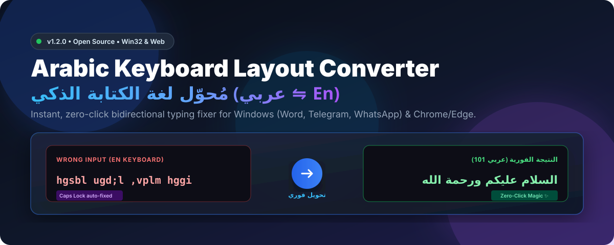
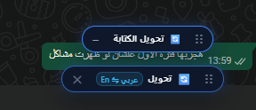
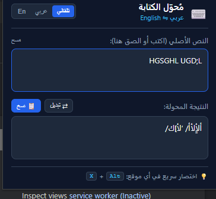
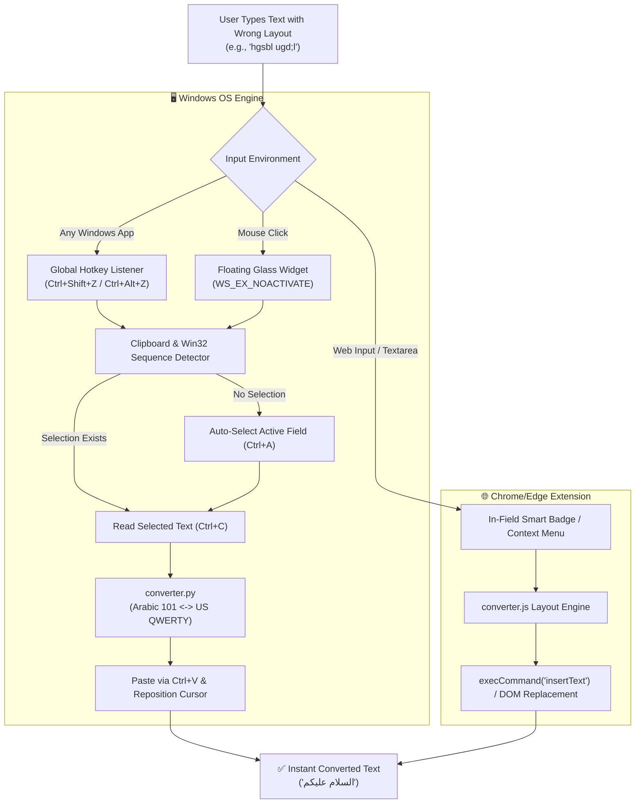

<div align="center">



# ⌨️ Arabic Keyboard Layout Converter
### مُحوّل لغة الكتابة الفوري بين العربية والإنجليزية

[](LICENSE)
[](https://github.com/)
[](https://python.org)
[](https://developer.chrome.com/docs/extensions/mv3/intro/)
[](https://github.com/)
[](CONTRIBUTING.md)

<p align="center">
  <b>حل نهائي وفوري لمشكلة الكتابة باللغة الخاطئة دون أن تلاحظ!</b><br>
  Instant, zero-click bidirectional typing fixer for <b>all Windows applications</b> (Word, Telegram, WhatsApp, Notepad, Excel) and <b>Chromium Browsers</b> (Chrome, Edge, Brave, Opera).
</p>

[**🚀 Quick Start**](#-quick-start) •
[**✨ Features**](#-key-features) •
[**🖥️ Windows App**](#️-windows-desktop-app) •
[**🧩 Chrome Extension**](#-chrome--edge-extension) •
[**🏗️ Architecture**](#️-architecture) •
[**عربي (دليل الاستخدام)**](#-دليل-الاستخدام-باللغة-العربية)

---

</div>

## 💡 The Problem & The Solution

Have you ever spent minutes typing a long sentence, looked up at your screen, and saw this?

```text
hgsbl ugd;l ,vplm hggi ,fv;hji
```

Instead of:

```text
السلام عليكم ورحمة الله وبركاته
```

**Arabic Keyboard Layout Converter** solves this universally across your entire operating system and browser with **a single shortcut or click**, without retyping, and **without even needing to highlight or select the text!**

| Mode | Input (Typo) | Output (Converted) |
| :--- | :--- | :--- |
| **EN ➔ AR** | `hgsbl ugd;l` | `السلام عليكم` |
| **EN ➔ AR (Caps Lock on)** | `HGSBL UGD;L` | `السلام عليكم` *(Auto-normalized!)* |
| **AR ➔ EN** | `اثممي صخقselection` | `hello world` |
| **Ligatures** | `gh / GH / Gh` | `لا / لإ / لأ` *(Correct Arabic 101 rules)* |

---

## ✨ Key Features

- ⚡ **Zero-Click Instant Conversion:** In any chat input (WhatsApp, Telegram, Discord, Chrome search bar), simply press the hotkey or click the floating widget — it automatically detects the text in the active input field and replaces it instantly!
- 🪟 **Universal Windows Support:** Works natively in **all desktop software**: Microsoft Office, Word, Notepad, Telegram, Slack, VS Code, Browser tabs, etc.
- ⌨️ **Multi-Hotkey Engine:** Supports `Ctrl + Shift + Z`, `Ctrl + Alt + Z`, `Ctrl + Shift + X`, and `Ctrl + Alt + X` simultaneously.
- 🔕 **0% Taskbar Clutter (Silent Background):** Runs smoothly in the background without cluttering your Windows Taskbar or Alt+Tab switcher.
- 🎈 **Glassmorphism Floating Widget:** A draggable, always-on-top pill with minimize/dismiss (`✕`) and context menu options.
- 🧩 **Chrome / Edge Extension (Manifest V3):** Built with modern Web Extension standards, offering an in-field badge, right-click context menu, and tab shortcuts.
- 🔤 **Smart Layout Engine:** Full support for Arabic 101 Standard Layout, ligatures (`لا`, `لأ`, `لإ`, `لآ`), diacritics (Tashkeel), and uppercase Caps-Lock auto-recovery.
- 🔒 **100% Offline & Private:** Zero network requests, zero telemetry, zero analytics. Your clipboard data never leaves your device.

---

## 📸 Screenshots & Previews

<div align="center">

### Floating Smart Widget (Desktop & Web)

*Draggable, unobtrusive widget floating over active apps like WhatsApp, Telegram, or any text editor.*

<br>

### Browser Extension Popup & Controls

*Modern dark-mode popup with layout toggle, live testing field, and settings.*

</div>

---

## 🚀 Quick Start

### 1️⃣ Windows Desktop App

> **Requirement:** Windows 10/11 with Python 3.8+ (Pure standard library — zero `pip install` required!).

1. Clone or download this repository:
   ```bash
   git clone https://github.com/OfficialMoSaleh/Arabic-Keyboard-Layout-Converter.git
   cd Arabic-Keyboard-Layout-Converter
   ```
2. Launch with a single click:
   - **Normal Launch:** Double-click [`تشغيل_تطبيق_الويندوز.bat`](Run_App.bat) or [`Run_App.bat`](Run_App.bat).
   - **Silent Launch (No CMD window):** Double-click [`تشغيل_صامت.vbs`](تشغيل_صامت.vbs).
3. **Usage:**
   - Type anywhere in Windows.
   - Press **`Ctrl + Shift + Z`** or **`Ctrl + Alt + Z`** (or click the floating widget).
   - Your mistyped text converts instantly!

---

### 2️⃣ Chrome / Edge Browser Extension

1. Open your Chromium browser and navigate to:
   - Chrome: `chrome://extensions/`
   - Edge: `edge://extensions/`
2. Enable **Developer mode** (top right switch).
3. Click **Load unpacked** (تحميل حزمة غير مضغوطة).
4. Select the `chrome-extension` folder inside this repository.
5. **Usage:**
   - In any input box or textarea on any webpage, the smart badge `[ 🔄 تحويل ]` appears.
   - Or press **`Ctrl + Shift + X`** / **`Alt + X`** / Right-click ➔ **تحويل النص (عربي ⇋ En)**.

---

### 3️⃣ Standalone Web Tool (Offline Playground)

Double-click [`web-tool/index.html`](web-tool/index.html) to open a standalone, zero-dependency offline web tool in any modern browser.

---

## 🏗️ Architecture



---

## 📁 Repository Structure

```text
├── assets/                          # Badges, SVG banner, and screenshots
│   ├── banner.svg                   # High-res vector header banner
│   ├── floating-badge-preview.png   # Floating widget screenshot
│   └── extension-preview.png        # Extension popup screenshot
│
├── chrome-extension/                # Manifest V3 Chrome/Edge Extension
│   ├── manifest.json                # V3 manifest configuration
│   ├── background.js                # Service worker for context menu
│   ├── content.js                   # In-field movable floating badge
│   ├── converter.js                 # JS layout mapping engine
│   ├── popup.html / popup.js        # Extension popup interface
│   └── icons/                       # Extension icon assets (16/48/128px)
│
├── windows-app/                     # Native Windows Desktop Application
│   ├── app.py                       # Main GUI, floating pill & Win32 hooks
│   ├── app.ico                      # Custom application icon
│   ├── converter.py                 # Pure Python layout conversion core
│   └── clipboard_helper.py          # 64-bit safe ctypes Win32 clipboard API
│
├── web-tool/                        # Offline standalone browser playground
│   └── index.html                   # Responsive offline converter page
│
├── Run_App.bat                      # Universal Windows launcher script
├── Start_Windows_App.bat            # Fast launch wrapper
├── تشغيل_تطبيق_الويندوز.bat         # Arabic launcher shortcut
├── تشغيل_صامت.vbs                   # Silent VBS launcher (0% console flash)
├── CONTRIBUTING.md                  # Contribution guidelines
├── LICENSE                          # MIT License
└── README.md                        # Project documentation
```

---

## 📖 دليل الاستخدام باللغة العربية

### المشكلة التي يحلها المشروع:
عند الكتابة السريعة على لوحة المفاتيح، كثيراً ما ينسى المستخدم تغيير لغة الإدخال، فيتفاجأ بعد كتابة جملة طويلة بظهور نصوص غير مفهومة مثل `hgsbl ugd;l` بدلاً من `السلام عليكم` أو العكس. هذا المشروع يحل هذه المشكلة في **أقل من ثانية واحدة وبدون أي مجهود!**

### 🌟 المميزات الرئيسية:
1. **التحويل الفوري بدون تحديد:** لست مضطراً لتظليل النص! اضغط على الاختصار وأنت داخل حقل الكتابة (في واتساب، تيليجرام، وورد، المتصفح) وسيتم تحويل النص المكتوب تلقائياً في مكانه.
2. **يعمل في كل مكان:** متوافق مع كافة برامج نظام ويندوز والمتصفحات.
3. **أيقونة عائمة خفيفة:** شريط عائم على الشاشة يمكنك تحريكه إلى أي مكان أو إخفاؤه.
4. **يعمل في الخلفية دون إزعاج:** لا يظهر في شريط المهام (Taskbar) ليظل سطح مكتبك نظيفاً ومرتباً.
5. **معالجة الـ Caps Lock:** لو كان زر Caps Lock مفعلاً بالخطأ وكتبت حروفا كبيرة، يقوم البرنامج بتصحيحها واستخراج الحروف العربية الصحيحة.
6. **دعم كامل لحروف اللام ألف:** (`لا`, `لأ`, `لإ`, `لآ`) بدقة 100%.

### ⌨️ الاختصارات المتاحة:
- في الويندوز: **`Ctrl + Shift + Z`** أو **`Ctrl + Alt + Z`** أو **`Ctrl + Shift + X`**
- في متصفح كروم/إيدج: **`Ctrl + Shift + X`** أو **`Alt + X`** أو النقر على الزر العائم بجوار حقل الكتابة.

---

## 🤝 Contributing

Contributions, bug reports, and feature suggestions are highly appreciated!
Please feel free to check out [CONTRIBUTING.md](CONTRIBUTING.md) to get started.

1. Fork the Project.
2. Create your Feature Branch (`git checkout -b feature/AmazingFeature`).
3. Commit your Changes (`git commit -m 'feat: Add some AmazingFeature'`).
4. Push to the Branch (`git push origin feature/AmazingFeature`).
5. Open a Pull Request.

---

## 📜 License

Distributed under the **MIT License**. See [`LICENSE`](LICENSE) for more details.

---

<div align="center">
  <sub>Built with ❤️ for the Arabic &amp; International Open-Source Community by <b>Mohamed Saleh</b></sub>
</div>
